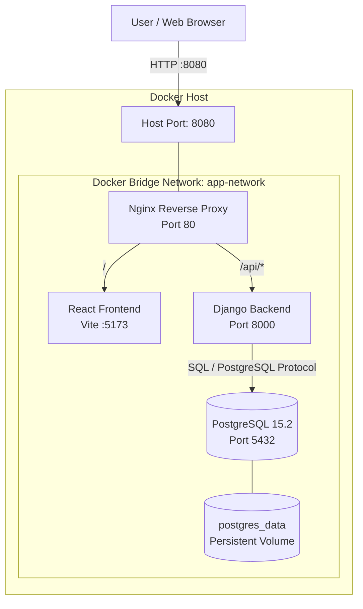

# System Architecture

## Overview

The application consists of four Docker services:
PostgreSQL, Django Backend, React Frontend, and Nginx.

Nginx acts as the single entry point for external HTTP
requests and routes traffic to the appropriate service.

## Architecture Diagram

## Request Flow

1. The user accesses the application through
   `http://localhost:8080`.
2. Nginx receives the HTTP request on port 80
   inside its container.
3. Requests to `/` are forwarded to the React Frontend
   running on port 5173.
4. Requests to `/api/` are forwarded to the Django
   Backend running on port 8000.
5. Django communicates with PostgreSQL on port 5432
   to retrieve or store application data.
6. PostgreSQL data is persisted in the
   `postgres_data` Docker volume.

## Network Design

- All four services communicate through the
  `app-network` Docker bridge network.
- Nginx is the only service exposed to the host.
- Host port `8080` maps to Nginx container port `80`.
- PostgreSQL and Django ports are not published
  directly to the host.
- Docker Compose service names are used for
  internal service discovery.

## Service Components

| Service | Technology | Internal Port |
|---|---|---:|
| nginx | Nginx | 80 |
| frontend | React + Vite | 5173 |
| backend | Django 4.2 | 8000 |
| postgres | PostgreSQL 15.2 | 5432 |
